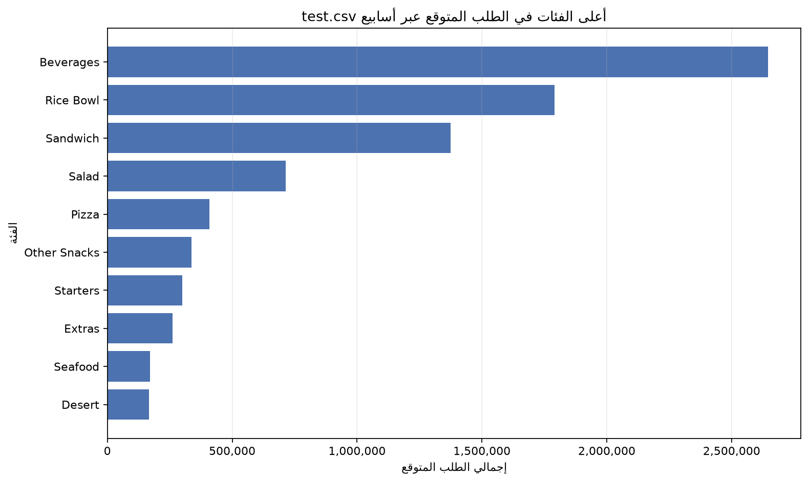

# تحليل طلب الوجبات

## وصف المشكلة

يحلل هذا المشروع بيانات الطلب التاريخية لشركة توصيل وجبات لمساعدة فرق التشغيل والتخطيط على فهم الطلب بحسب الوجبة والفئة ومركز التجهيز، ومراجعة الترويج والأسعار والتذبذب. النتائج وصفية ولا تُعامل الارتباطات على أنها دليل سببي.

## أهم ثلاث نتائج

1. بلغ إجمالي الطلبات **119,557,485** عبر **456,548** سجلًا، ضمن أرقام أسابيع من 1 إلى 145.
2. تركز الطلب: أكبر **22 من 51 وجبة** حققت **81.18%** من الطلب، وأكبر **5 من 14 فئة** حققت **81.40%**؛ وتصدرت `Beverages` بنسبة **33.86%**.
3. كان وسيط `num_orders` **310** مع وجود ترويج و**122** بدونه، بينما بلغ ارتباط Spearman بين الخصم والطلب **0.1218**؛ هذه نتائج ارتباطية لا تثبت وجود أثر سببي للترويج أو الخصم على الطلب.

للتفاصيل والمنهج والقيود والتوصيات، راجع [تقرير العميل](reports/client_report.md) والرسوم في [reports/figures](reports/figures/).

## التنبؤ وتعلم الآلة

يتضمن [دفتر التنبؤ الأسبوعي](notebooks/05_demand_forecasting.ipynb) خط أساس لإجمالي الطلب الأسبوعي. كما يوفر [سكربت Random Forest](scripts/06_random_forest_demand.py) تقييمًا زمنيًا على آخر عشرة أسابيع معلّمة، ويستخدم بعد ذلك كل بيانات التدريب للتنبؤ بصفوف الأسابيع 146–155 في `test.csv`. يقارن التقييم الطلب المتوقع بالحقيقي وبخط أساس طلب الأسبوع السابق للوجبة/المركز حيث يتوفر سجل سابق. لا يحتوي `test.csv` على `num_orders` فعلية؛ لذلك لا يمكن حساب MAE أو التحقق من الدقة على أسابيع الاختبار ذاتها.

بعد تشغيل السكربت، تُحفظ التنبؤات في `reports/random_forest_test_predictions.csv`، والملخص الجاهز للإدراج في التوثيق في `reports/random_forest_client_insight.md`، والرسم المخصص في `reports/figures/random_forest_category_forecast.png`. يجيب الرسم عن سؤال: **أي فئات الوجبات تستحق أولوية مراجعة الشراء خلال أفق الاختبار؟** استخدم التوقعات لترتيب المراجعة فقط؛ لا تحولها مباشرةً إلى كميات شراء دون مراعاة المخزون الحالي ومهلة التوريد ومستوى الخدمة والهدر.

### نتيجة مخصصة للعميل

في توقعات الأسابيع **146–155**، كانت `Beverages` الفئة ذات أعلى إجمالي متوقع: **2,645,735 طلبًا (30.6%)** من الإجمالي المتوقع. شكّلت أعلى عشر فئات **94.6%** من التوقعات، ما يجعلها نقطة بداية مناسبة لمراجعة الشراء والتوافر. هذا تجميع لتنبؤات النموذج وليس طلبًا فعليًا أو مقياسًا للربحية.



في التحقق التاريخي على الأسابيع **136–145**، بلغ MAE للنموذج **108.09** طلب لكل سجل. وعلى السجلات ذات الطلب المرصود في الأسبوع السابق (تغطية **95.2%**)، كان MAE لخط أساس الأسبوع السابق **81.78** مقابل **110.70** للنموذج؛ لذا لا يُنصح باستبدال خط الأساس بهذا النموذج قبل تحسينه واختباره على نوافذ زمنية إضافية. لا يمكن حساب MAE لصفوف `test.csv` لغياب `num_orders` الفعلية.

تشمل خطوات المشروع خط أساس سابقًا بمقاييس `WAPE`؛ هذه نتيجة منفصلة عن Random Forest ولا تُخلط بمقاييسه.

## البيانات

تُقرأ ملفات CSV الخام محليًا من `data/dataraw/`، لكنها مستثناة من هذا المستودع العام ولا تُرفع مع المشروع:

- `train.csv`: سجل الطلبات التاريخية، بما فيه `week` و`num_orders` والأسعار ومؤشرات الترويج.
- `meal_info.csv`: تعريف الفئات والمطابخ، ويرتبط عبر `meal_id`.
- `fulfilment_center_info.csv`: خصائص مراكز التجهيز، ويرتبط عبر `center_id`.
- `test.csv`: لا يحتوي على `num_orders`، لذلك لا يستخدم لحساب الطلب الفعلي أو تقييم التنبؤ مقابل نتائج حقيقية.

لتشغيل الدفاتر، جهّز ملفات البيانات محليًا داخل `data/dataraw/` دون رفعها إلى المستودع. تُقرأ الملفات الخام فقط ولا تعدّل. أرقام الأسابيع ورموز المدن والمراكز ليست تواريخ أو أسماء جغرافية فعلية.

## استخدام الذكاء الاصطناعي

استُخدم مساعد ذكاء اصطناعي لدعم تنظيم كود التحليل والرسوم وصياغة المسودة التقريرية. حُسبت الأرقام المعروضة من ملفات المشروع محليًا باستخدام خطوات pandas في الدفاتر، وتحتاج التوصيات والقرارات التشغيلية إلى مراجعة أصحاب البيانات. لا يثبت استخدام الذكاء الاصطناعي صحة الاستنتاجات ولا يغيّر القيود الإحصائية الموضحة في التقرير.

## طريقة التشغيل

يتطلب السكربت Python و`pandas` و`matplotlib` و`scikit-learn`. أضف Jupyter عند الحاجة إلى تشغيل الدفاتر. من PowerShell في مجلد المشروع:

```powershell
py -3 -m venv .venv
.\.venv\Scripts\Activate.ps1
python -m pip install -r requirements.txt
python -m pip install jupyterlab
jupyter lab notebooks/analysis.ipynb
```

شغّل خلايا الدفاتر بالترتيب باستخدام **Run All**. لتشغيل نموذج Random Forest من جذر المشروع:

```powershell
python scripts/06_random_forest_demand.py
```

ينتج دفتر التحليل الرسوم الأساسية في `reports/figures/`. دفتر تجهيز البيانات موجود في `notebooks/02_data_preparation.ipynb`؛ يمكن تشغيله بالطريقة نفسها عند الحاجة.

يقرأ التحليل المسار `data/dataraw/` الموجود فعليًا. إذا شُغّل الدفتر من مجلد `notebooks/` أو من جذر المشروع، فإنه يحفظ الرسوم في `reports/figures/`. لا تنقل أو تعدّل ملفات البيانات الخام.
