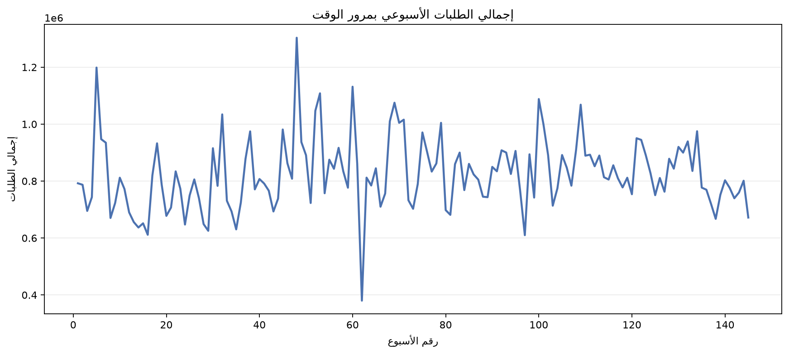
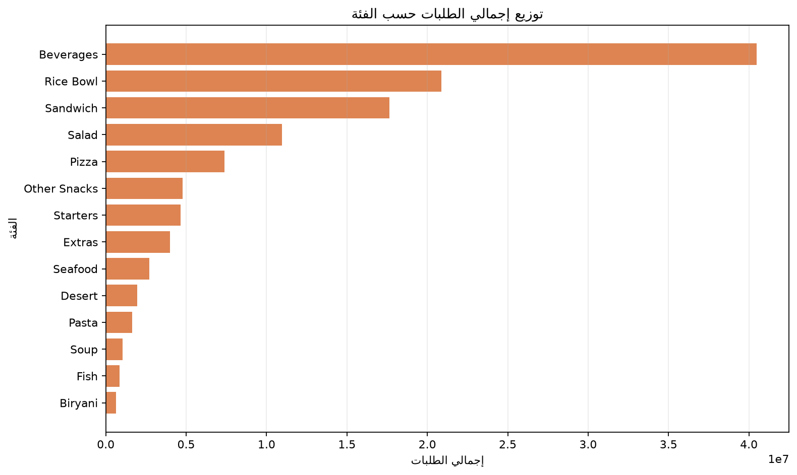
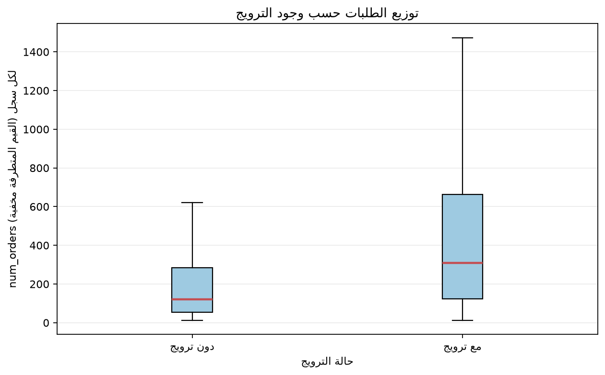
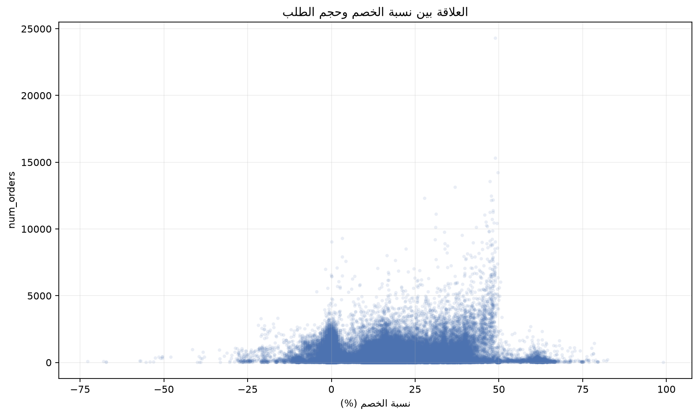

# تقرير موجز للعميل: الطلب والعروض

## الخلاصة بالأرقام

| المؤشر | النتيجة | ماذا تعني؟ |
|---|---:|---|
| إجمالي الطلب المسجل | **119,557,485** | مجموع `num_orders` في **456,548** سجلًا |
| فترة البيانات | **145 أسبوعًا مرمّزًا** | أرقام الأسابيع ليست تواريخ تقويمية |
| تركّز الوجبات | **22 من 51 وجبة = 81.18%** | جزء صغير نسبيًا من الوجبات يمثل معظم الطلب |
| أكبر فئة | **Beverages: 40,480,525 (33.86%)** | نحو طلب واحد من كل ثلاثة كان ضمن هذه الفئة |
| وسيط الطلب في السجل | **310 مع ترويج، و122 بدونه** | قيمة السجل الأوسط أعلى مع الترويج؛ لا يثبت ذلك أن الترويج رفع الطلب |
| علاقة الخصم بالطلب | **0.1218؛ ارتباط موجب ضعيف** | لا تكفي هذه العلاقة للتنبؤ بالطلب أو إثبات أثر الخصم |

> **كيف نقرأ الأرقام؟** `num_orders` هو عدد الطلبات المسجل في الصف. و«الوسيط» هو القيمة التي تقع في منتصف السجلات بعد ترتيبها؛ ليس متوسطًا ولا يعني أن كل سجل حقق هذا العدد.

## الرسوم: ماذا نرى وما القرار الذي تدعمه؟

### 1. إجمالي الطلبات عبر الأسابيع

**القراءة المباشرة:** تراوح إجمالي الطلب الأسبوعي بين **380,065** في الأسبوع **62** و**1,303,457** في الأسبوع **48**. يوضح الخط تذبذب الإجمالي من أسبوع إلى آخر؛ لا يوضح سبب القمم أو الانخفاضات. أرقام الأسابيع تسلسلية وليست تواريخ فعلية. وإذا ظهر `1e6` عند المحور، فالمقياس بالملايين.

### 2. إجمالي الطلب حسب فئة الوجبة

**القراءة المباشرة:** طول الشريط يقارن إجمالي الطلب بين الفئات. تتصدر `Beverages` بـ **40,480,525 طلبًا (33.86%)**، تليها `Rice Bowl` بـ **20,874,063**. أكبر **5 فئات من 14** تمثل معًا **81.40%** من الطلب. الرمز `1e7` على المحور يعني أن التدريج بعشرات الملايين.

### 3. الطلب المسجل مع ترويج وبدونه

**القراءة المباشرة:** الخط داخل كل صندوق هو الوسيط: **310** مع الترويج مقابل **122** بدونه. الصندوق يبيّن نطاق النصف الأوسط من السجلات؛ ويظهر الرسم أيضًا اختلافًا أكبر في الطلبات المسجلة مع الترويج. شملت المقارنة **67,674 سجلًا مع ترويج** و**388,874 بدونه**. المقارنة وصفية؛ فقد تختلف الوجبات والمراكز والأسابيع والأسعار بين المجموعتين، لذا لا تنسب الفرق إلى الترويج وحده.

### 4. الخصم والطلب المسجل

**القراءة المباشرة:** كل نقطة تمثل سجلًا؛ انتشار النقاط رأسيًا عند نسب خصم متقاربة يعني أن الطلب يختلف كثيرًا حتى عند خصم مشابه. معامل الارتباط **0.1218** موجب لكنه ضعيف، ولا يثبت أن الخصم يرفع الطلب. تظهر قيم سالبة للخصم في بعض السجلات؛ وقد سُجل `checkout_price` أعلى من `base_price` في **116,101 سجلًا (25.43%)**، وهي نقطة تستحق مراجعة تعريف الخصم والأسعار.

## نتائج إضافية للتخطيط

- **الوجبات:** بلغت حصة أعلى **22 وجبة من أصل 51** نسبة **81.18%** من الطلب. تصدرت الوجبة `meal_id=2290` بإجمالي **9,770,303 طلبات**.
- **مراكز التجهيز:** ساهم أكبر **51 مركزًا من أصل 77** بـ **80.60%** من الطلب. تصدر `center_id=13` بإجمالي **4,296,545 طلبًا**. المعرّفات رموز ولا تكشف مواقع فعلية.
- **تذبذب الطلب:** بلغ معامل التذبذب للوجبة `meal_id=1971` **1.45** مع **5,728,620 طلبًا**. هذا مؤشر لترتيب الوجبات التي تحتاج مراجعة، وليس كمية مخزون مقترحة.

## ما الذي نوصي به؟

| الإجراء | الدليل من البيانات | كيف نتابع النتيجة؟ |
|---|---|---|
| راجع توافر الوجبات الأعلى طلبًا، وابدأ بالوجبات التي تجمع بين طلب كبير وتذبذب مرتفع. لا تعتمد كمية شراء قبل معرفة المخزون الحالي ومهلة التوريد ومستوى الخدمة المطلوب. | أعلى **22 وجبة** تمثل **81.18%** من الطلب؛ و`meal_id=1971` سجلت **5,728,620 طلبًا** ومعامل تذبذب **1.45**. | نفاد المخزون والهدر لكل وجبة ومركز، أسبوعيًا؛ واضبط المخزون وفق مهلة التوريد ومستوى الخدمة. |
| أعطِ الفئات الخمس الأعلى طلبًا أولوية في مراجعة التوافر، وابدأ بـ `Beverages`. لا تعتبر حجم الطلب دليلًا على الربحية. | أكبر **5 فئات** تمثل **81.40%**؛ و`Beverages` تمثل **33.86%** من الطلب. | تلبية الطلب والنفاد والهدر حسب الفئة، إلى جانب هامش المساهمة وتكلفة التشغيل. |
| اختبر العروض قبل توسيعها: قارن مجموعة تتلقى العرض بمجموعة مماثلة لا تتلقاه، وسجّل تكلفة العرض. | وسيط الطلب المسجل **310 مع الترويج** و**122 بدونه**، لكن هذه مقارنة غير عشوائية ولا تثبت أثر الترويج. | الزيادة في هامش المساهمة مقارنة بمجموعة ضابطة، مع متابعة تكلفة العرض والطلبات الإضافية والهدر. |

## حدود القراءة

- **مصدر التحليل:** `train.csv` بعد ربط بيانات الوجبات والمراكز باستخدام `meal_id` و`center_id`. لم يُستخدم `test.csv` لقياس طلب فعلي لأنه لا يحتوي على `num_orders`.
- **الفترة والموقع:** الأسابيع **1–145** رموز تسلسلية، ومعرّفات المراكز والمدن رموز؛ لا نستنتج منها تواريخ أو مواقع حقيقية.
- **الترويج والخصم:** الفروق والارتباطات الواردة وصفية وليست دليلًا على علاقة سببية. أظهر الاختبار الاستكشافي فرقًا دالًا بعد التصحيح في **45 من 51 وجبة قابلة للمقارنة**، لكن تكرار السجلات والعوامل المختلفة بين المجموعات تحدّ من الاستنتاج.
- **جودة البيانات:** لم تُسجل قيم مفقودة أو صفوف مكررة بالكامل أو مفاتيح ربط غير متطابقة. بقيت السجلات التي يكون فيها `checkout_price > base_price` والقيم المتطرفة كما هي، ولم تُصحح آليًا.
- **الأسعار والربحية:** `checkout_price` سعر مسجل، وليس إثباتًا للمبلغ المحصل. لا تتوفر بيانات التكاليف أو هامش الربح؛ لذلك لا نعرض السعر مضروبًا في الطلب على أنه إيراد.
