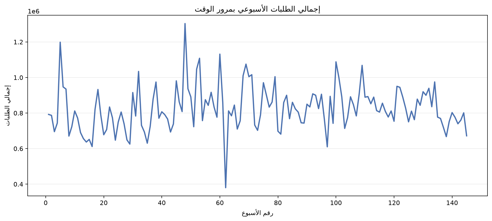
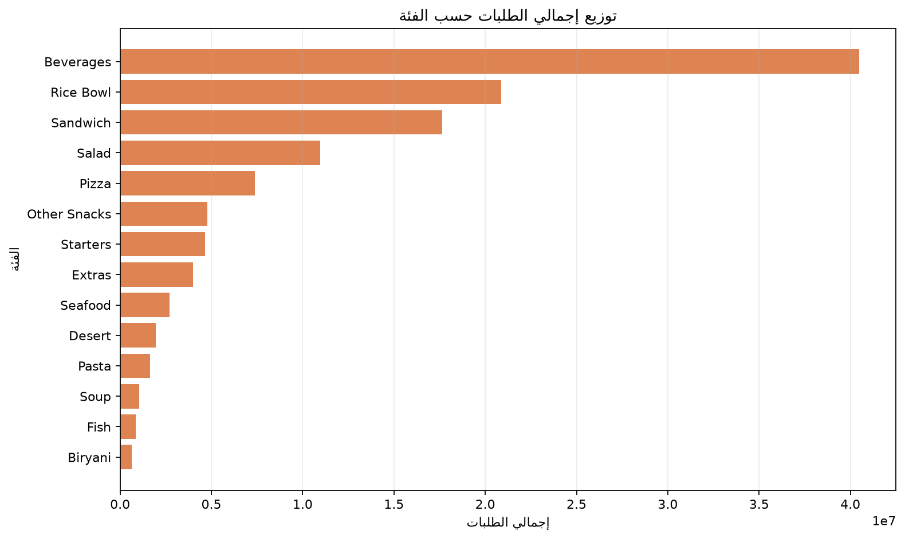
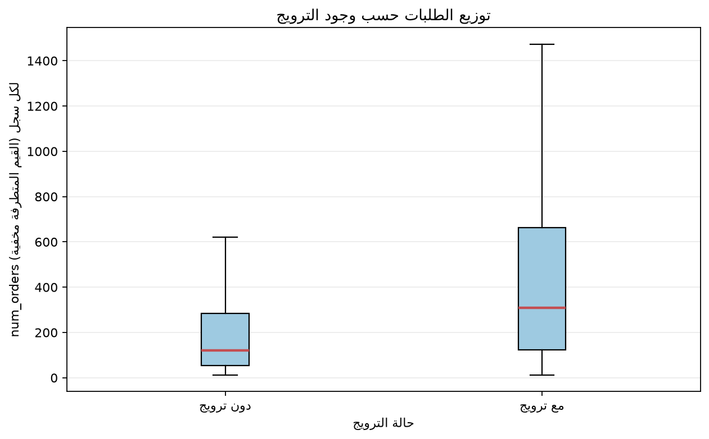
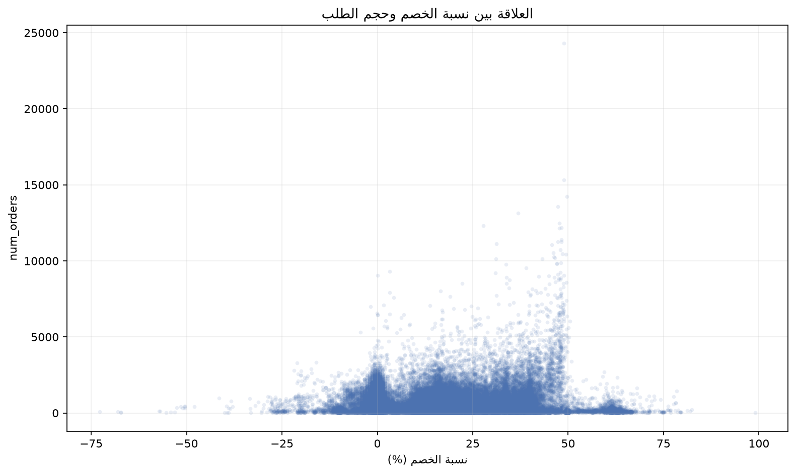

# تقرير العميل: تحليل الطلب والعروض

## ملخص تنفيذي — خمسة أسطر

1. بلغ إجمالي الطلبات **119,557,485** عبر **456,548** سجلًا خلال الأسابيع المرمّزة 1–145.
2. تركز الطلب: **22 من 51 وجبة** حققت **81.18%** من الطلبات، وغطت أكبر خمس فئات **81.40%**.
3. سجلت فئة **Beverages** أكبر حصة منفردة: **40,480,525 طلبًا (33.86%)**.
4. كان وسيط `num_orders` **310** مع وجود ترويج مقابل **122** بدونه؛ هذه مقارنة وصفية لا تثبت أثرًا سببيًا.
5. بلغ ارتباط Spearman بين `discount_pct` و`num_orders` **0.1218**، وهو ارتباط موجب ضعيف لا يثبت السببية.

## إجابات أسئلة التحليل الستة

### 1. ما حجم الطلب وكيف يتغير أسبوعيًا؟

بلغ الإجمالي **119,557,485 طلبًا**. أرقام `week` هي مؤشرات أسبوعية وليست تواريخ تقويمية: تراوح الإجمالي الأسبوعي بين **380,065** في الأسبوع 62 و**1,303,457** في الأسبوع 48. يوضح الرسم المسار عبر الأسابيع المتاحة، ولا يمكن منه تحديد تواريخ فعلية أو تفسير أسباب القمم والانخفاضات.

### 2. ما الوجبات التي تساهم بأكبر قدر من الطلب؟

بلغت مجموعة باريتو **22 وجبة من أصل 51** لتجاوز 80% من الطلبات، ووصلت حصتها إلى **81.18%**. كانت الوجبة `meal_id=2290` الأعلى، بإجمالي **9,770,303 طلبات**. يفيد ذلك في ترتيب مراجعة التوافر والتخطيط للمخزون، لكنه لا يحدد وحده كمية المخزون المثلى.

### 3. كيف يتوزع الطلب على الفئات؟

حققت أكبر **5 فئات من أصل 14** نسبة **81.40%** من الطلبات. تصدرت `Beverages` بإجمالي **40,480,525 طلبًا (33.86%)**، تليها `Rice Bowl` بـ **20,874,063**. يظهر ترتيب الفئات في الرسم.

### 4. هل يتركز الطلب في مراكز تجهيز محددة؟

شكلت أكبر **51 مركزًا من أصل 77** نحو **80.60%** من الطلبات. تصدر المركز `center_id=13` بإجمالي **4,296,545 طلبًا**. المراكز والمدن في البيانات ممثلة برموز؛ لا تسمح هذه النتيجة بتحديد أسماء مدن أو مواقع فعلية.

### 5. كيف تختلف الطلبات المسجلة مع ترويج عن دون ترويج؟

وفق تعريف الترويج بأنه تفعيل `emailer_for_promotion` أو `homepage_featured`، شملت البيانات **67,674** سجلًا مع ترويج و**388,874** سجلًا بدونه. كان وسيط الطلبات في السجل **310** مع الترويج و**122** بدونه. وأظهر الاختبار الاستكشافي المستخدم في الدفتر فروقًا دالة بعد تصحيح Holm في **45 من 51 وجبة قابلة للمقارنة**؛ لكن التقريب الإحصائي وافتراض استقلال السجلات لا يعالجان تكرار الوجبات والمراكز عبر الزمن، لذا لا تثبت النتائج أن الترويج رفع الطلب.

### 6. ما علاقة الخصم بحجم الطلب، وأي الوجبات تستحق متابعة التذبذب؟

بلغ معامل Spearman بين `discount_pct` و`num_orders` **0.1218**، ما يشير إلى ارتباط موجب ضعيف في هذه السجلات، لا إلى علاقة سببية أو أثر تجاري مؤكد. يوضح مخطط الانتشار التشتت الكبير بين الخصم والطلب. وللمراجعة التشغيلية، سجلت الوجبة `meal_id=1971` معامل تذبذب **1.45** مع **5,728,620 طلبًا**؛ الجمع بين حجم الطلب وتذبذبه مفيد لترتيب المتابعة، لكنه لا يكفي لحساب مخزون الأمان دون مهلة التوريد ومستوى الخدمة والهدر.

## التوصيات

| القرار المقترح | الرقم الداعم | مؤشر النجاح والمتابعة |
|---|---|---|
| ابدأ بمراجعة توافر الوجبات الأعلى مساهمة، مع إدراج الوجبات ذات الطلب المرتفع والتذبذب العالي في مراجعة المخزون قبل اعتماد كميات جديدة. | **22 من 51 وجبة** تمثل **81.18%** من الطلب؛ `meal_id=1971` له **5,728,620 طلبًا** ومعامل تذبذب **1.45**. | معدل نفاد المخزون والهدر لكل وجبة/مركز، مع مقارنة أسبوعية قبل وبعد أي تعديل في المخزون. عاير حدود المخزون باستخدام مهلة التوريد ومستوى الخدمة المستهدف. |
| وجّه مراجعة توافر الفئات أولًا إلى الفئات الخمس الأعلى طلبًا، وابدأ بـ `Beverages`، دون افتراض أن الحصة الأعلى تعني ربحية أعلى. | أكبر خمس فئات تمثل **81.40%**؛ `Beverages` تمثل **33.86%** (**40,480,525 طلبًا**). | نسبة تلبية الطلب ومعدل النفاد حسب الفئة، إلى جانب هامش المساهمة وتكلفة الهدر؛ لا تستخدم حجم الطلب بديلًا عن الربح. |
| لا توسّع العروض اعتمادًا على فرق الطلب المشاهد وحده؛ نفّذ تجربة ترويج مضبوطة بمجموعة مقارنة، وسجّل تكاليف العرض والهامش. | وسيط الطلب **310** مع ترويج مقابل **122** بدونه، لكن ارتباط الخصم بالطلب ضعيف (**Spearman = 0.1218**) والسجلات متكررة عبر الزمن. | الزيادة في هامش المساهمة لكل طلب مقارنةً بمجموعة ضابطة، مع متابعة تكلفة الترويج والطلبات الإضافية ومعدل الإلغاء/الهدر. |

## الحدود والافتراضات

- **التواريخ:** لا تتوفر تواريخ تقويمية فعلية في التحليل؛ `week` رقم أسبوع تسلسلي (1–145)، لذلك لا ننسب النتائج إلى سنوات أو مواسم تقويمية.
- **الجغرافيا:** رموز مثل `city_code` و`center_id` لا تكشف أسماء المدن أو مواقعها الفعلية.
- **السببية:** الفرق بين سجلات الترويج وبدونه وارتباط Spearman نتائج ارتباطية/وصفية. قد تؤثر عوامل مثل نوع الوجبة والمركز والأسبوع والسعر واختيار العروض في المقارنة؛ لا تثبت هذه النتائج وجود أثر سببي للترويج أو الخصم على الطلب.
- **الاختبارات:** اختبار Mann–Whitney في الدفتر يعتمد تقريبًا طبيعيًا مع تصحيح للتعادلات وتصحيح Holm، لا تنفيذ SciPy؛ كما أن السجلات المتكررة قد تخالف افتراض استقلال المشاهدات. تُعامل الدلالة بوصفها استكشافية.
- **الأسعار:** `checkout_price * num_orders` قيمة سعرية تقديرية وليست إيرادًا محققًا؛ لا تتوفر بيانات التحصيل أو التكلفة أو هامش الربح.
- **الجودة:** فحوص البيانات لم تجد قيمًا مفقودة أو صفوفًا مكررة كاملة أو مفاتيح ربط غير متطابقة. بقيت حالات `checkout_price > base_price` (116,101 سجلًا، 25.43%) والقيم المتطرفة ضمن البيانات للمراجعة، ولم تُصحح آليًا.
- **المصدر والنطاق:** `train.csv` بعد دمجه مع `meal_info.csv` و`fulfilment_center_info.csv` من `data/dataraw/`؛ لم تُستخدم `test.csv` لاستخلاص طلب فعلي لأنه لا يحتوي على `num_orders`.
